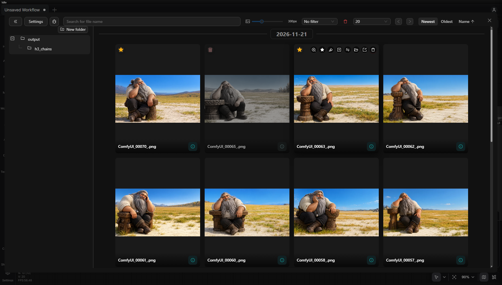

# ComfyUI Gallery — Fork

> Fork of [PanicTitan/ComfyUI-Gallery](https://github.com/PanicTitan/ComfyUI-Gallery).
> Original project by PanicTitan; this fork is maintained by Nivarrym.

A fast, native gallery for ComfyUI `output`: images, video, audio, 3D,
metadata, graph loaders and batch management.

## Fork highlights

- **Selection & batch actions** — Ctrl/Cmd+click, Shift+range, box selection,
  select all, batch ZIP download and batch delete.
- **Trash & favorites** — Space marks trash, F marks favorite; muted cards,
  card icons, preview auto-advance and **No filter / Favorites / Trash** filter.
- **Quick trash cleanup** — top-bar trash button deletes marked assets with an
  optional From/To date-time range.
- **Folder editing** — create, rename and delete empty folders from the sidebar
  and its right-click menu.
- **Comparison mode** — two images/videos with wipe divider, horizontal/vertical
  direction, Overlay/Fade modes, fit modes, 3×3 anchor and Swap A/B.
- **Mask editor** — open ComfyUI's built-in mask editor directly from a card or
  the selection toolbar.
- **Graph integration** — Add to Graph, Replace selected node, in-node image
  preview, and `Load Image / Video / Audio From Gallery` nodes.
- **Faster browsing** — lazy scans, cached WebP thumbnails, on-demand metadata,
  endless scroll, pagination, resizable sidebar, card-size slider and dark theme.

## Install

1. Copy `ComfyUI-Gallery-Fork` into `ComfyUI/custom_nodes/`.
2. Restart ComfyUI.
3. Open the gallery from the toolbar button or press **Ctrl+G**.

## Requirements

- ComfyUI with Python 3.10+
- `aiohttp`, `Pillow`, `watchdog`
- `ffmpeg` is recommended for video/audio metadata and previews

## Documentation

- [CHANGELOG.md](CHANGELOG.md) — complete fork history
- [FORK_CHANGES.md](FORK_CHANGES.md) — technical implementation notes
- [AUTHORS.md](AUTHORS.md) — attribution

---

Based on [ComfyUI-Gallery](https://github.com/PanicTitan/ComfyUI-Gallery) by
PanicTitan. Fork maintained by Nivarrym.
