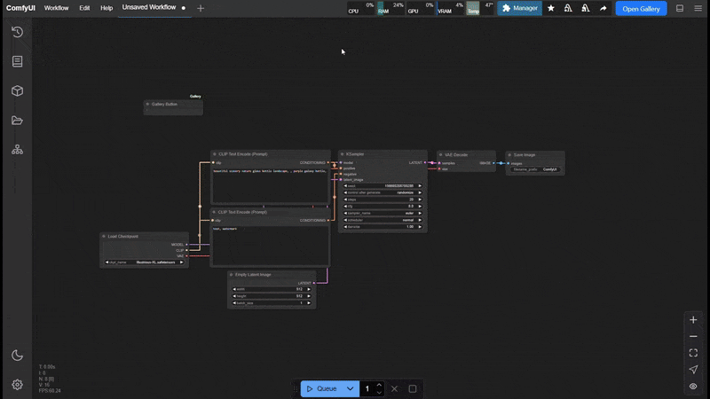

# ComfyUI Gallery — Fork

**Effortlessly Browse Your ComfyUI Image Outputs!**

Personal fork of ComfyUI Gallery, maintained by **KagePC** as
`ComfyUI-Gallery-Fork`.

This ComfyUI custom node provides a feature-rich, real-time gallery directly within your ComfyUI interface. View images, videos, GIFs, audio, and 3D models generated by your workflows, explore metadata, search, sort, move, and download files. Customize the gallery to your liking. No more digging through folders, your media output is instantly accessible and beautifully presented!



> **Visualize your creative output directly in ComfyUI, unlock image metadata, and manage your files with ease!**

> **This is a fork of [PanicTitan/ComfyUI-Gallery](https://github.com/PanicTitan/ComfyUI-Gallery).**
> It adds Shift/Ctrl/box selection, batch delete, per-card delete, a complete
> dark theme, and a reworked lazy/thumbnail performance path. See
> [FORK_CHANGES.md](FORK_CHANGES.md) for the full list and API additions.

## Key Features:

*   **Real-time Gallery Updates:** Leveraging ComfyUI's event system, the gallery instantly reflects new images, videos, and GIFs saved to your ComfyUI output folder and no manual refresh needed!
*   **Video and GIF Support:** Seamlessly displays and plays `.mp4`, `.webm` videos and `.gif` animations alongside your generated images.
*   **Video Hover Preview (v2.8.1):** Hovering a video card plays it looped. Hold Shift while hovering for sound; release Shift to mute. Leaving the card pauses it.
*   **3D Model Support (v2.7.0):** View `.obj`, `.glb`, `.gltf`, `.fbx`, `.stl`, `.usd`, `.usdz` 3D model files directly in the gallery with auto-generated thumbnails and an interactive 3D viewer.
*   **Image Metadata Inspection:** Extracts and displays detailed metadata embedded in your image files (PNG and JPEG).
*   **Enhanced Metadata Parser (v1.5.0, further improved in v2.0.0):** A robust, customizable, and modular metadata parser provides accurate and flexible extraction of workflow details.
*   **Easy Metadata Copy (v1.5.0):** Click on any metadata value (e.g., prompt, seed, model) to instantly copy it to your clipboard.
*   **Detailed Media Information Window:** Click "Info" on image cards to access a popup with a larger preview, structured metadata, and navigation. Videos and GIFs open directly in fullscreen for playback.
*   **Image Navigation (v1.5.0, React version in v2.0.0):** Easily navigate between images within the info view using previous and next buttons.
*   **Raw Metadata Viewer:** Dive into the technical details with the "Show Raw Metadata" button, presenting data in an interactive JSON viewer.
*   **Powerful Search and Sort:** Quickly locate media by filename search and organize your gallery by newest, oldest, or name.
*   **Single Name Sort (v2.12.0):** One Name segment toggles ascending/descending sort; its arrow icon reflects the current direction.
*   **Compact Settings (v2.12.0):** Settings are grouped into a two-column grid with short switches; the theme switch uses sun/moon icons.
*   **Move Files (v1.5.0, React version in v2.0.0):** Drag and drop images between folders directly within the gallery to reorganize your output.
*   **Delete Files (v1.5.0, React version in v2.0.0):** Delete unwanted images directly from the gallery with a confirmation prompt.
*   **Download Files (v1.5.0, React version in v2.0.0):** Download individual images with a single click from the info view, using the original filename.
*   **Batch Download (v2.0.0):** Select multiple images with Ctrl/Cmd+click, Shift+click for a range, or drag a box over the grid, then download all selected images at once as a ZIP file.
*   **Batch Delete (v2.3.0, improved in v2.8.0):** Select multiple images (or entire folders) and delete them in one request with confirmation and per-file error feedback. `Delete`/`Backspace` triggers the same action.
*   **Fast Selection (v2.8.0):** Shift-click range selection, box-drag selection with Ctrl/Cmd to add, Ctrl/Cmd+A select all, Esc clear.
*   **Quick Delete (v2.8.0):** A trash button appears in the corner of each card on hover.
*   **Reveal / Open Asset (v2.10.0):** On hover, each card also offers “Show in file manager” (selects the file in Explorer/Finder) and “Open in default application” buttons.
*   **Select Entire Folder (v2.3.0):** Ctrl/Cmd+Click a folder in the sidebar to select or deselect all images in that folder for batch operations (download/delete). Visual highlight indicates full-folder selection.
*   **Improved Batch Download (v2.3.0):** Download all selected images (including from multiple folders) as a ZIP file. 
    *   ⚠️ **Browser Limitation:** Batch download is performed client-side using JavaScript. Downloading very large folders or thousands of images may be limited by your browser's memory and performance. For best results, select a reasonable number of images at a time.
*   **Asynchronous Image Loading (v1.5.0, significantly enhanced in v2.0.0):** Images load asynchronously for a faster gallery startup and smoother browsing experience, utilizing a virtualized grid for performance.
*   **Improved UI (v2.0.0):** Complete rewrite with React for a modern, high-performance user interface.
*   **Customizable Settings:** Tailor the gallery with a dedicated settings panel:
    *   **Relative Path:** Change to your ComfyUI output path if no images appear.
    *   **Open Button Box Query:** Specify where the "Open Gallery" button is placed.
    *   **Open Button Label:** Personalize the text on the "Open Gallery" button.
    *   **Floating Button Mode:** Enable a draggable, floating "Open Gallery" button. Save its position across sessions.
    *   **Play Videos on Hover:** Control whether videos play automatically when hovering a card.
    *   **Hide Open Button:** Hide/Show the Open Gallery Button.
*   **Add to Graph (v2.15.0, video/audio in v2.16.0):** Card and multi-selection action buttons insert the matching `Load Image / Video / Audio From Gallery` node into the active graph, pre-selected to the chosen asset.
*   **Graph preview (v2.18.0):** `Load Image From Gallery` nodes display the selected image inside the node; the preview updates with the file dropdown and Add to Graph.
*   **Selection-aware preview (v2.17.0):** Clicking a card opens a selection preview; paging selects the viewed image and keeps the batch action toolbar above the preview mask. The magnifier button opens a read-only preview that never changes the selection and ignores Delete. The filename is shown above the image in both preview modes (v2.17.1).
*   **Load Image From Gallery (v2.14.0):** An `image` node that lists images from the ComfyUI `output` directory and all of its subfolders, including files generated in previous sessions. Returns `IMAGE` and `MASK`.
*   **Load Video / Audio From Gallery (v2.16.0):** `video` and `audio` nodes that recursively list output assets and return `VIDEO` / `AUDIO` respectively.
*   **Unload Models Node (v2.13.0):** A standalone `utils` output node that unloads all models and empties the device cache. An optional wildcard `trigger` input lets you enforce execution order in larger graphs.
    *   **Show Date Divider:** Control visibility of date dividers in the grid.
    *   **Dark/Light Mode Toggle (v2.0.0):** Instantly switch between dark and light themes for comfortable viewing, directly from the settings panel.
    *   **Enable/Disable Ctrl+G Shortcut (v2.1.0):** Toggle the keyboard shortcut for opening the gallery (Ctrl+G) on or off from the settings panel.
    *   **Expand All Folders (v2.3.1):** Choose whether the folder sidebar tree is fully expanded or collapsed by default, for easier navigation of large folder structures.
*   **Sidebar (Sider) Toggle (v2.0.0):** Collapse or expand the sidebar for a distraction-free or navigational experience.
*   **Resizable Sidebar (v2.9.0):** Drag the divider at the right edge of the folder tree to change its width; double-click the divider to reset. The width is remembered.
*   **Preview Size Slider (v2.9.0, top bar in v2.11.0):** A compact slider next to the pagination controls changes the asset card size (160–600 px) live while dragging; the chosen size is saved.
*   **Pagination (v2.11.0):** Choose `Endless scroll`, `20`, `40`, `60`, `100` or `200` cards per page. In fixed modes the ←/→ buttons switch pages; in Endless mode they are disabled.
*   **Viewport preview loading (v2.11.0):** Cards are laid out with a native CSS grid (smooth resizing), while thumbnails load only for cards on screen plus about two rows above/below.
*   **Hover to close button (v1.6.0, React version in v2.0.0):** A button appears in the header when dragging an image, allowing you to hover over it to close the gallery (useful for dropping images into your workflow).
*   **Hotkeys navigation (v1.7.0, React version in v2.0.0):** Simple navigation with ← → arrows and ESC button while viewing images on fullscreen (provided by Ant Design's Image Preview).

### New Features in this update

- **3D Model Support:** View `.obj`, `.glb`, `.gltf`, `.fbx`, `.stl`, `.usd`, `.usdz` files directly in the gallery with auto-generated thumbnails and an interactive 3D viewer (orbit, zoom, pan).
- **Image/Video Thumb Fit settings:** New settings to control whether image and video thumbnails in the grid are constrained by width or height. Useful for portrait vs. landscape outputs.
- **Subfolder path fix:** Relative paths like `./video` or `video` now work correctly for live monitoring, not just for scanning.
- **Improved file scanning:** Uses `os.scandir` for better performance on large output directories.
- **Batch delete improvements:** Better error handling and selection clearing after batch deletes.
- Audio support: `.wav`, `.mp3`, `.m4a`, `.flac` files are now detected and shown in the gallery with a generic thumbnail and an inline audio player.
- Persistent settings: Gallery settings are now saved to `user_settings.json` on the server and loaded automatically on startup.
- Configurable file extensions: You can configure which file extensions the gallery scans via the settings panel (comma-separated list).
- Non-blocking startup scan: The initial folder scan now runs in a background thread to avoid freezing ComfyUI on startup when scanning large collections.

## Get Started:

**1. Installation:**

*   **Using ComfyUI Manager (Recommended):**
    *   Open ComfyUI Manager.
    *   Go to "Install Custom Nodes".
    *   Search for `ComfyUI-Gallery` and install.
    *   **Restart ComfyUI.**

*   **Install via Git URL:**
    *   Navigate to your `ComfyUI/custom_nodes` directory.
    *   Clone this repository:
        ```bash
        git clone https://github.com/PanicTitan/ComfyUI-Gallery.git
        ```
    *   **Restart ComfyUI.**

**2. Install Python Dependencies:**

*   **Using ComfyUI Manager (Recommended):** ComfyUI Manager might prompt you to install missing dependencies. Click "Install Missing".
*   **Manual Installation:**
    ```bash
    cd ComfyUI/custom_nodes/ComfyUI-Gallery-Fork
    pip install -r requirements.txt
    ```
    (Note: The React frontend dependencies are built into the JavaScript bundle; `requirements.txt` is for Python backend dependencies if any are specific to this node beyond core ComfyUI.)

**3. Using the Gallery:**

*   **Open Gallery:** Click the "Open Gallery" button (label and location customizable in settings) in your ComfyUI menu.
*   **Browse, Search, Sort:** Navigate folders in the sidebar, use the search bar, and sort images/media using the header controls.
*   **View Media and Metadata:** Click on image cards to view larger previews and metadata. Click on video/GIF cards for fullscreen playback. Click "Info" on an image card to access detailed metadata and management options. Use the navigation buttons (< and >) to browse through images within the info view.
*   **Copy Metadata:** Click on any metadata value (e.g., prompt, seed) within the info view to copy it to the clipboard.
*   **Copy Image to Clipboard:** In the image info view, click the copy icon button to copy the image to your clipboard.
*   **Move Images:** Click and drag an image card and drop it onto a folder in the left-hand navigation panel.
*   **Delete Image:** Click on "Info" for an image, then click on the "Delete" button in the info view, and confirm the deletion.
*   **Download Image:** Click on "Info" for an image, and in the image preview, click the "Download" icon button.
*   **Batch Download:** Hold Ctrl (or Cmd on Mac) and click multiple image cards to select them. Then click the "Download Selected" button in the gallery header to download all selected images as a ZIP file.
*   **Access Settings:** Click the "Settings" button in the gallery popup header.
*   **Toggle Sidebar:** Use the sidebar toggle button (◀ or ▶) in the gallery header to collapse or expand the navigation panel.
*   **Switch Theme:** Open Settings and toggle Dark/Light mode.
*   **Raw Metadata View:** In the info modal for an image, click "Show Raw Metadata" to inspect the full metadata.

## Global Logging and Observer Control (v2.4.0+)

The backend now supports **global log suppression** and **observer type switching** via the Gallery UI settings:

- **Disable Logs:** Suppresses all backend logs for a cleaner console. Toggle this in the Gallery settings panel. All logs are routed through a global `gallery_log()` helper and respect the setting at runtime.
- **Observer Type:** Switch between native and polling observers for file monitoring. This can help with compatibility on some systems. Change this in the Gallery settings panel.

**If you still see logs:**
- Make sure you are running the latest version and have restarted ComfyUI after updating.
- All custom node logs (not from dependencies) should be suppressed when "Disable Logs" is enabled in the Gallery settings.

## Changelog

*   **v2.18.1 (fork):**
    *   **Single image loader:** Add to Graph no longer renames the created node to the filename, so there is only one clearly named `Load Image From Gallery` node type.

*   **v2.18.0 (fork):**
    *   **Node image preview:** `Load Image From Gallery` now shows the selected image directly inside the graph node, including nodes created by Add to Graph.

*   **v2.17.2 (fork):**
    *   **Sticky date divider:** removed the scroll padding/section gap above date headers so the sticky divider sits flush against the search bar and no interactive card content can peek through the gap.

*   **v2.17.1 (fork):**
    *   **Preview filename:** both selection and read-only image previews show the current filename above the image, so the user always knows which asset is on screen.

*   **v2.17.0 (fork):**
    *   **Selection-aware preview:** opening a card preview selects the viewed image; paging updates the selection, so Delete cannot target a different asset.
    *   **Preview action toolbar:** selected-asset actions render in a portal above the preview mask and stay clickable.
    *   **Read-only magnifier preview:** new card button opens a preview without changing selection; Delete is ignored while it is open.

*   **v2.16.1 (fork):**
    *   **Add to graph fix:** uses the active subgraph when one is open, handles ComfyUI's typed-array viewport, and places nodes in the first free visible slot instead of pushing them off-screen.

*   **v2.16.0 (fork):**
    *   **Load Video From Gallery:** new `video` node returning `VIDEO`, backed by `InputImpl.VideoFromFile`.
    *   **Load Audio From Gallery:** new `audio` node returning `AUDIO` (`waveform` + `sample_rate`).
    *   **Graph shortcuts:** card and multi-select actions now choose the correct image, video or audio node automatically.

*   **v2.15.0 (fork):**
    *   **Add to graph:** each image card has an action button that creates a `Load Image From Gallery` node in the active graph with the image pre-selected.
    *   **Multi-add:** the selection toolbar can add all selected image assets as separate nodes.
    *   **Fork identity:** repository/package renamed to `ComfyUI-Gallery-Fork`, with KagePC authorship metadata.

*   **v2.14.0 (fork):**
    *   **Load Image From Gallery:** new `image` node that recursively lists files from ComfyUI's `output` directory, including previous sessions. Returns `IMAGE` and `MASK`.
    *   **Install path:** live junction updated after the workspace move.

*   **v2.13.0 (fork):**
    *   **Unload Models node:** new output node under `utils` that calls `unload_all_models()` and `soft_empty_cache(force=True)`; optional wildcard trigger for execution ordering.

*   **v2.12.1 (fork):**
    *   **Fresh previews:** asset and thumbnail URLs now include a per-file revision (`mtime_ns-size`), so reused output filenames can no longer serve a deleted old image from the browser cache.
    *   **Fresh listing on open:** opening the gallery forces a scan refresh; deleted files disappear and newly generated files appear immediately.

*   **v2.12.0 (fork):**
    *   **Name sorting:** replaced the duplicate `Name ↑` / `Name ↓` segments with one `Name` segment whose arrow toggles direction.
    *   **Settings redesign:** compact two-column sections, shorter switches and fields; theme toggle now shows sun/moon icons.

*   **v2.11.0 (fork):**
    *   **Pagination:** Endless scroll / 20 / 40 / 60 / 100 / 200, with ←/→ page buttons (disabled in Endless).
    *   **Endless preview loading:** only assets within the viewport plus about two rows are loaded; more are added while scrolling.
    *   **Smooth resize:** replaced the JS virtualizer with a native CSS grid driven by CSS variables; slider and sidebar resizing reflow without re-rendering cards.

*   **v2.10.1 (fork):**
    *   **Resize performance:** preview size updates are frame-coalesced and moved into the header, thumbnails no longer reload within a size bucket, and sidebar dragging is rAF-throttled without re-rendering the tree.

*   **v2.10.0 (fork):**
    *   **Reveal and open:** per-card buttons to select the asset in the host file manager and to open it in the default associated application.

*   **v2.9.0 (fork):**
    *   **Preview size slider:** bottom-left slider resizes asset cards live (160–600 px) and persists the choice.
    *   **Resizable sidebar:** drag the divider to resize the folder tree; double-click resets to 320 px. Width is persisted.

*   **v2.8.2 (fork):**
    *   **Header layout:** reserved space for the modal close button, so the sort control no longer overlaps the X.

*   **v2.8.1 (fork):**
    *   **Live theme preview:** toggling Dark Mode in Settings applies instantly; Cancel/close reverts, Save persists.
    *   **Batch delete fix:** the confirmation dialog now renders above the gallery modal, so Delete Selected works from the bottom toolbar.
    *   **Video hover:** hovering a video card plays it looped; hold Shift for sound, release to mute, leave to pause.

*   **v2.8.0 (fork):**
    *   **Selection:** Shift-click ranges, box-drag selection (Ctrl/Cmd additive), Ctrl/Cmd+A, Esc clears, Delete/Backspace deletes selected.
    *   **Batch delete:** One request for all selected assets, optimistic UI updates and per-file failures. Per-card trash button on hover.
    *   **Dark theme:** Complete token/CSS-variable theme across modal, sidebar, grid, cards, settings, metadata, JSON view and scrollbars.
    *   **Performance:** Lightweight listing without metadata, lazy `/Gallery/metadata`, cached WebP `/Gallery/thumbnail`, single-flight scan cache, non-blocking `asyncio.to_thread` scanning, fixed watchdog observer, closed Pillow handles, compact date-divider rows.
    *   **Diagnostics:** Client/server performance timeline, `/Gallery/perf`, paged thumbnail queue (6 concurrent), `debugPerf` setting and `?galleryPerf=1`.
    *   **Videos:** `preload="metadata"` and play on hover instead of autoplaying every visible video.

*   **v2.7.1:**
    *   **Performance Improvement:** Changes in how the folders are parsed to improve gallery loading times for folders with many images.
    *   **Symlink Deduplication Setting:** Added a new setting "Deduplicate Symlinks". When enabled (default), symlinked content is shown only once. When disabled, symlinks are shown everywhere they appear without causing infinite recursion.
    *   **Fix:** Resolved a frontend tree parsing issue on Windows where subfolders wouldn't nest properly due to backslash paths.
    *   **Fix:** Addressed an issue where portrait videos and images would open in a very large size, ignoring the "Fit Height" constraint.

*   **v2.7.0:**
    *   3D model support: View `.obj`, `.glb`, `.gltf`, `.fbx`, `.stl`, `.usd`, `.usdz` files with auto-generated thumbnails and interactive 3D viewer.
    *   New thumb fit settings: Control whether image and video thumbnails are constrained by width or height (`imageThumbFit`, `videoThumbFit`).
    *   Fix: Relative subfolder paths (e.g., `./video`, `video`) now correctly resolve for both scanning and live file monitoring (Issue #37).
    *   Fix: Video thumbnails in the grid no longer appear overly zoomed (Issue #36) — videos default to fitting by height.
    *   Improved file scanning performance using `os.scandir` instead of `os.listdir`.
    *   Improved batch delete: Better error handling, selection clearing after deletion, and success/failure feedback.
    *   Improved raw metadata modal: Prevents accidental drag/swipe interactions.
    *   Audio cards now display a large icon and inline player.
    *   Static file serving always serves from base output directory for correct subfolder URL resolution.

*   **v2.6.0:**
    *   Audio support: `.wav`, `.mp3`, `.m4a`, `.flac` files are detected and shown in the gallery with a generic thumbnail, inline audio player.
    *   Persistent settings: Gallery settings are saved to `user_settings.json` on the server and automatically loaded on startup (GET/POST `/Gallery/settings`).
    *   Configurable file extensions: Specify which file extensions the gallery scans via the settings panel (comma-separated list).
    *   Non-blocking startup scan: The initial folder scan runs in a background thread to avoid freezing ComfyUI on startup when scanning large collections.
    *   Fix: Resolved preview-type persistence bug where images could open with the media renderer after viewing video.
    *   Misc: Settings UI and server-side handling improved for more robust defaults and safer merging of saved settings.

*   **v2.1.0:**
    *   New setting: Enable/Disable Ctrl+G shortcut for opening the gallery, configurable in the settings panel.
*   **v2.0.0 (React Rewrite):**
    *   Complete rewrite with React for a modern, high-performance UI.
    *   Asynchronous image loading and instant search, with a virtualized grid for smooth browsing of large collections.
    *   Enhanced metadata viewer (with collapsible sections and raw JSON view) and batch file management (batch download as ZIP).
    *   Improved drag-and-drop for moving files.
    *   Redesigned settings panel with new options like Dark/Light mode.
    *   Collapsible sidebar for a more focused view.
    *   Ctrl+Click (Cmd+Click on Mac) images to select multiple for batch operations.
    *   Numerous bug fixes and optimizations.
*   **v1.7.0:**
    *   Hotkeys navigation: Use ← → arrows and ESC for fullscreen navigation.
*   **v1.6.0:**
    *   Hover to close button for quick workflow actions.
*   **v1.5.0 (Major Update):**
    *   New metadata parser: More customizable, modular, and accurate.
    *   Easy metadata copy: Click any metadata value to copy.
    *   Move files: Drag and drop images between folders.
    *   Delete files: Delete images directly from the gallery.
    *   Download files: Download images with their original filenames.
    *   Image navigation: Browse images within the info view.
    *   Asynchronous image loading: Faster gallery startup.
    *   Improved UI: More responsive and user-friendly design.
    *   Bug fixes.
*   **Previous Versions:**
    *   Real-time Updates with Watchdog (Python).
    *   Video and GIF Support.
    *   No More Gallery Node (UI-based access).
    *   Settings Panel.
    *   Improved Floating Button.

## Credits and Inspiration:

*   **ComfyUI:** [https://github.com/comfyanonymous/ComfyUI](https://github.com/comfyanonymous/ComfyUI)
*   **ComfyUI-Crystools Metadata Extraction:** [https://github.com/crystian/ComfyUI-Crystools](https://github.com/crystian/ComfyUI-Crystools)
*   **aiohttp:** [https://github.com/aio-libs/aiohttp](https://github.com/aio-libs/aiohttp)
*   **Pillow (PIL):** [https://python-pillow.org/](https://python-pillow.org/)
*   **ComfyUI Manager:** [https://github.com/ltdrdata/ComfyUI-Manager](https://github.com/ltdrdata/ComfyUI-Manager)
*   **Ant Design:** [https://github.com/ant-design/ant-design](https://github.com/ant-design/ant-design)
*   **ahooks:** [https://github.com/alibaba/hooks](https://github.com/alibaba/hooks)
*   **JSZip:** [https://github.com/Stuk/jszip](https://github.com/Stuk/jszip)
*   **FileSaver.js:** [https://github.com/eligrey/FileSaver.js](https://github.com/eligrey/FileSaver.js)
*   **react-json-view:** [https://github.com/microlinkhq/react-json-view](https://github.com/microlinkhq/react-json-view)
*   **React:** [https://github.com/facebook/react](https://github.com/facebook/react)
*   **react-window:** [https://github.com/bvaughn/react-window](https://github.com/bvaughn/react-window)
*   **react-virtualized:** [https://github.com/bvaughn/react-virtualized](https://github.com/bvaughn/react-virtualized)
*   **React Three Fiber:** [https://github.com/pmndrs/react-three-fiber](https://github.com/pmndrs/react-three-fiber)
*   **Three.js:** [https://github.com/mrdoob/three.js](https://github.com/mrdoob/three.js)

**Enjoy using the ComfyUI Gallery! Contributions, bug reports, and feature requests are welcome!**

<div align="center">
     
</div>

---
*README.md Generated By AI Assistant ✨*